# DeviceDesk – Architecture & Engineering Specification

## 1. Executive Summary & Design System

**DeviceDesk** is an enterprise-grade IT Asset Management & Customer Support Portal engineered with a Warm Minimal / Natural Enterprise aesthetic. It marries algorithmic scheduling via a **Min-Heap Priority Queue** with **AI-assisted issue triage**, role-based access control (RBAC), hardware lifecycle tracking, and real-time operational analytics.

### Exact Brand Palette
| Token | Hex Code | Visual Application |
|---|---|---|
| **Cream** | `#D9D28B` | Accent highlights, badge backgrounds, status chips |
| **Sage** | `#B2BD7E` | Secondary buttons, subtle borders, success indicators |
| **Olive** | `#8E9162` | Sub-headings, focus rings, auxiliary controls |
| **Forest Green** | `#6A795D` | Primary action buttons, brand logo, active navigation |
| **Main Background** | `#F7F7F1` | Workspace body background |
| **Card Background** | `#FFFEF9` | Elevated surfaces, floating panels, modal containers |
| **Primary Text** | `#25291F` | High-contrast headings and body typography |
| **Secondary Text** | `#777B68` | Descriptive labels, metadata, audit timestamps |
| **Border Neutral** | `#E9E7D9` | Card boundaries, table gridlines, form outlines |

---

## 2. High-Level System Architecture

```mermaid
graph TD
    A[Client Browser - React 18 / TypeScript] --> B[AppProvider & Global Reactive Context]
    B --> C[Navigation & RBAC Guard]
    B --> D[Min-Heap Priority Queue Engine]
    B --> E[Modular AI Ticket Classifier]
    B --> F[Storage & Persistence Layer]

    subgraph User Experience Modules
        C --> M1[Module 1: Authentication & SSO]
        C --> M2[Module 2: Employee 4-Slide Carousel Dashboard]
        C --> M3[Module 3: My Devices Hardware Registry]
        C --> M4[Module 4: Raise Support Ticket Intake]
        C --> M5[Module 5: My Tickets Directory]
        C --> M6[Module 6: Ticket Details & 5-Stage Timeline]
        C --> M7[Module 7: IT Support Operations & Live Dispatch]
        C --> M8[Module 8: Enterprise Asset Inventory]
        C --> M9[Module 9: Employee IAM & Role Management]
        C --> M10[Module 10: Operational Intelligence Analytics]
    end

    subgraph Core Algorithmic Engine
        D --> H1[Binary Min-Heap Array]
        D --> H2[Tuple Comparator: priority ASC, createdAt ASC, ticketId ASC]
        D --> H3[Atomic Mutex Lock for Concurrency Protection]
        D --> H4[SLA Starvation Escalation Policy]
    end

    subgraph Intelligent Triage Services
        E --> S1[Category Classifier]
        E --> S2[Business Rule Policy Validator]
        E --> S3[Device Entity Extractor]
        E --> S4[Diagnostic Recommender]
        E --> S5[Jaccard Historical Matcher]
    end
```



---

## 3. Data Structure & Algorithms: Min-Heap Priority Queue

### Ordering Invariant
Support tickets are deterministically scheduled using a **3-tuple composite comparator**:
$$\text{Ticket A} < \text{Ticket B} \iff (\text{score}_A < \text{score}_B) \lor (\text{score}_A = \text{score}_B \land t_A < t_B) \lor (\dots \land \text{id}_A < \text{id}_B)$$

1. **Primary Key**: `priorityScore ASC`
   - Critical = 1
   - High = 2
   - Medium = 3
   - Low = 4
2. **Secondary Key (Tie-Breaker)**: `createdAt ASC` (Strict FIFO order guarantees older tickets take precedence within the same severity level)
3. **Tertiary Key**: `ticketId ASC` (Deterministic tie-breaking)

### Algorithmic Complexity

| Method | Time Complexity | Space Complexity | Description |
|---|---|---|---|
| `enqueue(ticket)` | $\mathcal{O}(\log n)$ | $\mathcal{O}(1)$ | Inserts ticket and bubbles up to restore min-heap property |
| `dequeue()` | $\mathcal{O}(\log n)$ | $\mathcal{O}(1)$ | Removes root (highest priority) and bubbles down root replacement |
| `peek()` | $\mathcal{O}(1)$ | $\mathcal{O}(1)$ | Inspects highest priority eligible ticket without mutation |
| `updatePriority(id, p)`| $\mathcal{O}(n) + \mathcal{O}(\log n)$ | $\mathcal{O}(1)$ | Updates severity and dynamically re-heapifies position |
| `remove(id)` | $\mathcal{O}(n) + \mathcal{O}(\log n)$ | $\mathcal{O}(1)$ | Removes non-root ticket when directly claimed or cancelled |
| `atomicAssignNext()` | $\mathcal{O}(\log n)$ | $\mathcal{O}(1)$ | Atomic thread-safe assignment locking to prevent duplicate dispatch |
| `applyAgingPolicy()` | $\mathcal{O}(n)$ | $\mathcal{O}(1)$ | Scans waiting items and escalates tickets waiting past SLA thresholds |

### Concurrency Protection & Starvation Prevention
- **Atomic Assignment Mutex**: The `atomicAssignNext` routine acquires an internal synchronization lock to prevent race conditions where multiple IT agents dispatch the top ticket simultaneously.
- **Anti-Starvation Aging Policy**: To eliminate starvation for `Low` priority tickets during heavy ticket volume, any ticket waiting longer than its maximum SLA window is automatically upgraded to a higher priority score.

---

## 4. Module Decomposition

### Module 1: Login / Register & RBAC
- **Authentication**: Email/Password form validation, password visibility toggle, remember-me persistence.
- **Roles**:
  - `employee`: Access to personal devices, ticket creation, ticket status, comments.
  - `it_support`: Access to Live Priority Queue, Next Ticket Dispatch, priority recalibration, agent workloads.
  - `admin`: Full system access including Asset CRUD, Employee Management, and Analytics.
- **One-Click Personas**: Instant switcher to evaluate user, agent, and administrator perspectives.

### Module 2: Employee Dashboard (4-Slide Horizontal Carousel)
- **Design Requirement**: Sections are presented sequentially via an interactive horizontal carousel.
- **Slide 1 – Overview**: Welcome banner, 5 metric cards, quick actions, recent ticket feed.
- **Slide 2 – My Tickets**: Tabular list of employee tickets with live queue status.
- **Slide 3 – My Devices**: Assigned hardware cards with serial numbers, warranty countdowns, and quick issue reporting.
- **Slide 4 – Support Activity**: Audit log and response feed from IT agents.
- **Interaction**: Keyboard arrow navigation (Left/Right), pagination dots, touch swipe gesture support.

### Module 3: My Devices
- Hardware inventory filterable by category (Laptop, Monitor, Mobile, Network).
- Days-remaining warranty calculation with warning pills.
- Deep link to pre-populate device information into ticket creation.

### Module 4: Raise Support Ticket Intake & AI Copilot
- **Intake**: Title, description, category, related device, priority selection, file attachments.
- **AI Classification**:
  - Category auto-detection (Hardware, Software, Network, Access, Other).
  - Business Rule validation: Prohibits employees from arbitrarily flagging non-outage issues as `Critical`.
  - Entity extraction: Detects model names and serials.
  - Recommended self-troubleshooting steps.
  - Historical similarity matching.

### Module 5: My Tickets Directory
- Comprehensive table of user tickets.
- Real-time search, multi-criteria filtering (Priority, Status), and sorting (Newest, Oldest, Priority Score).

### Module 6: Ticket Details & Lifecycle Progression
- **Visual 5-Stage Timeline**: `Open → In Progress → On Hold → Resolved → Closed` with precise transition timestamps.
- Interactive two-way comment thread between requester and support agents.
- Priority override modal for authorized IT agents.

### Module 7: IT Support Dashboard & Live Queue
- Real-time metric cards for `Critical`, `High`, `Medium`, and `Low` open tickets.
- **Live Priority Queue table**: Real waiting duration, rank `#1 NEXT` badge, atomic "Process Next Ticket" action.
- Agent workload breakdown (In Progress vs Resolved).
- SLA countdown watchlist identifying tickets nearing breach limits.

### Module 8: Asset Inventory
- Full hardware CRUD: Add, Edit, Delete (with confirmation), Assign, and Unassign.
- Stock KPI counts: Total, Assigned, Available, Under Repair, Retired.

### Module 9: Employee Management
- IAM directory tracking employee department, active assets, and open tickets.
- Account status toggling (`active` vs `inactive`).
- Role assignment promotion/demotion modal.

### Module 10: Admin Analytics
- Interactive SVG charts:
  - Donut chart: Priority distribution.
  - Bar chart: Volume by category.
  - Line chart: Influx vs resolution trend.
  - Workload metrics: Throughput per IT agent.
  - Asset status breakdown.
- Dynamic date range filters (Today, 7 Days, 30 Days, 90 Days).

---

## 5. Database Schema & Models

### `User`
```typescript
interface User {
  _id: string;
  employeeId: string;
  name: string;
  email: string;
  passwordHash?: string;
  department: string;
  role: 'employee' | 'it_support' | 'admin';
  accountStatus: 'active' | 'inactive' | 'suspended';
  createdAt: string;
  avatar?: string;
  phone?: string;
}
```

### `Asset`
```typescript
interface Asset {
  _id: string;
  assetId: string;
  deviceName: string;
  category: 'Laptop' | 'Desktop' | 'Mobile' | 'Monitor' | 'Peripherals' | 'Network';
  manufacturer: string;
  model: string;
  serialNumber: string;
  purchaseDate: string;
  warrantyExpiry: string;
  assignedTo: string | null;
  assignedToName?: string;
  status: 'assigned' | 'available' | 'under_repair' | 'retired';
  condition: 'Excellent' | 'Good' | 'Fair' | 'Needs Service';
  assignedDate?: string;
  specs?: string;
  createdAt: string;
}
```

### `Ticket`
```typescript
interface Ticket {
  _id: string;
  ticketId: string;
  title: string;
  description: string;
  category: 'Hardware' | 'Software' | 'Network' | 'Access' | 'Other';
  priority: 'Critical' | 'High' | 'Medium' | 'Low';
  priorityScore: number; // 1 to 4
  status: 'Open' | 'In Progress' | 'On Hold' | 'Resolved' | 'Closed';
  requesterId: string;
  requesterName: string;
  requesterEmail: string;
  requesterDept: string;
  assetId: string | null;
  assetName?: string;
  assignedAgentId: string | null;
  assignedAgentName?: string;
  createdAt: string;
  updatedAt: string;
  startedAt?: string;
  resolvedAt?: string;
  closedAt?: string;
  slaDeadline: string;
  attachments?: TicketAttachment[];
  aiSummary?: string;
  aiSuggestedSteps?: string[];
}
```

---

## 6. Verification & Automated Unit Testing

The core Priority Queue scheduling engine is verified via 10 automated unit tests in `src/algorithms/PriorityQueue.test.ts`:
1. Empty queue boundary verification.
2. Strict priority level ordering (Critical > High > Medium > Low).
3. Exact specification example: `Ticket D (Critical 10:10) → Ticket B (Critical 10:15) → Ticket C (High 10:05) → Ticket A (Medium 10:00)`.
4. FIFO tie-breaking for equal priority items.
5. Deterministic ticketId tie-breaking.
6. Dynamic heap re-balancing on priority update.
7. Safe ticket removal.
8. Rejection of non-Open tickets from waiting queues.
9. Concurrency lock duplicate assignment prevention.
10. SLA starvation aging escalation.
